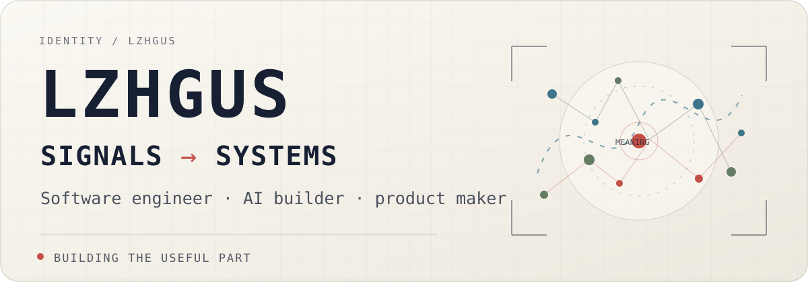

<picture>
  <source media="(prefers-color-scheme: dark)" srcset="./assets/hero-dark.svg">
  <source media="(prefers-color-scheme: light)" srcset="./assets/hero-light.svg">
  
</picture>

I build reliable systems, turn emerging technology into useful products, and keep the complexity behind the interface.

`BACKEND SYSTEMS` · `VECTOR EMBEDDINGS` · `AI & RETRIEVAL` · `PRODUCT ENGINEERING`

---

## `// CURRENT_SIGNAL`

- **Focus** — Vector embeddings, retrieval, and AI systems.
- **Range** — Ten years across backend, cloud, full stack, and native applications.
- **Approach** — Understand the system, simplify the interface, ship the useful part.

## `// SELECTED_SYSTEMS`

### `SHIP / 01` · [Capso](https://github.com/lzhgus/Capso)

Open-source screenshot and screen recording for macOS, built natively with Swift and SwiftUI.

### `AUGMENT / 02` · [Claude Code Companion](https://github.com/lzhgus/cc-plugin-codex)

Connects Codex and Claude Code for focused reviews, adversarial checks, and delegated work.

### `NAVIGATE / 03` · [MacCue](https://github.com/lzhgus/MacCue)

A fast, native command palette for the real menu commands, scripts, and workflows in every Mac app.

### `SIMPLIFY / 04` · [Gauss](https://github.com/lzhgus/Gauss)

A native macOS calculator that makes expressions, units, currencies, dates, and conversions feel simple.

## `// HOW_I_BUILD`

**Systems first.** I like clear boundaries, dependable infrastructure, and software that stays understandable as it grows.

**Product all the way through.** Backend, frontend, native, or AI—the job is not finished until the experience works for a real person.

**Curious by default.** Day dreamer, night thinker, system builder.

## `// OFFLINE_MODE`

Photography and fleeting light · Manchester United · Monster hunting · Worlds with a little Miyazaki wonder

---

**Life is long, take it easy.**

[All repositories](https://github.com/lzhgus?tab=repositories) · [X](https://x.com/lzhgus) · [Email](mailto:lzhgusapp@gmail.com)

<!-- Static, local, and tracking-free. -->
